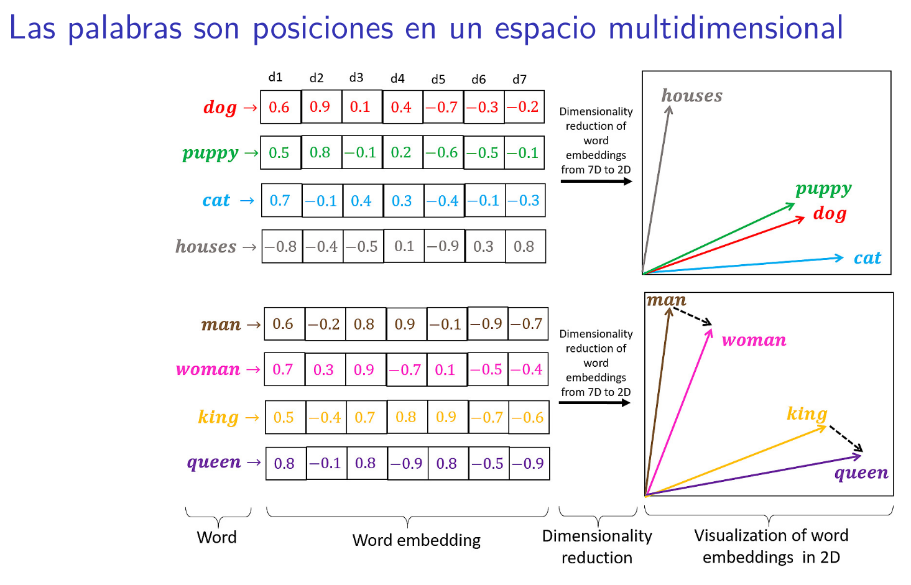
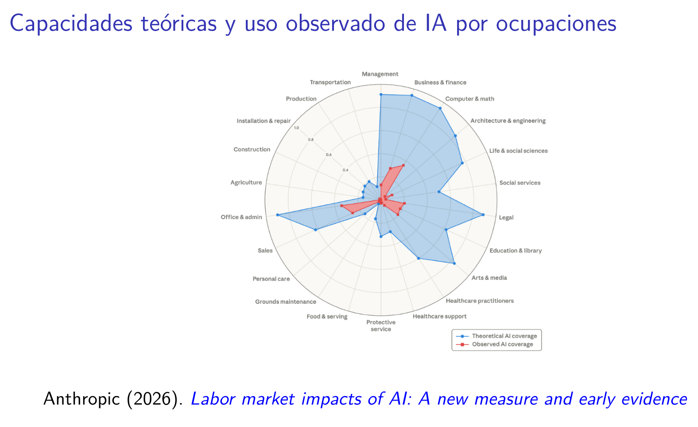
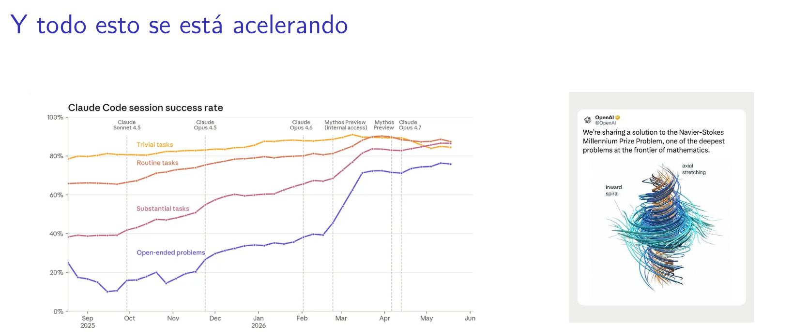
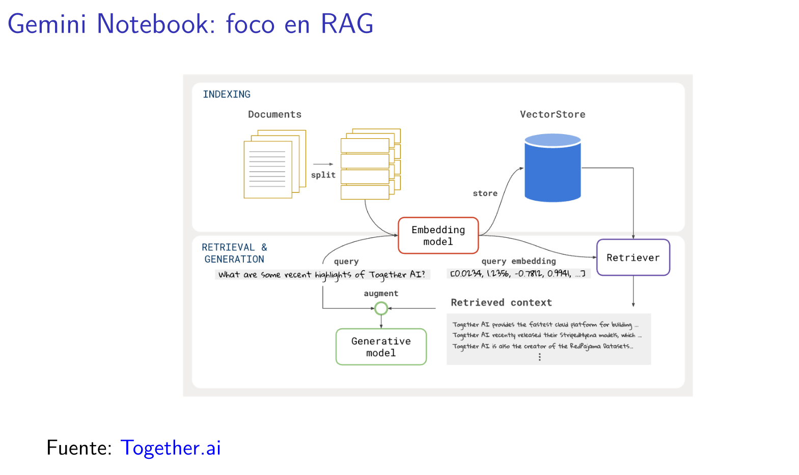

# Fundamentación

La inteligencia artificial generativa (IAG) se ha instalado en la vida universitaria a una velocidad mayor que la capacidad de las instituciones para comprenderla, orientarla y aprovecharla. Estudiantes, docentes e investigadores ya la utilizan cotidianamente para leer, escribir, buscar información, preparar clases o analizar datos, mientras buena parte de las universidades carece de criterios compartidos sobre sus usos, límites y riesgos. Esta **brecha entre adopción y alfabetización** se traduce en prácticas desiguales y poco reflexionadas, y a la vez desaprovecha un potencial concreto de mejora del trabajo académico.

Las preguntas que plantea la IAG atraviesan las tres actividades que definen a una comunidad universitaria:

- **Docencia**: cómo preservar el sentido formativo de actividades y evaluaciones, cómo orientar a estudiantes hacia un uso transparente y cómo apoyarse en estas herramientas sin delegar el criterio pedagógico.
- **Estudio**: cómo usar la IA para comprender, sintetizar y ejercitar sin sustituir el aprendizaje, cómo reconocer información errónea o referencias inexistentes y qué significa la autoría de un trabajo elaborado con asistencia de IA.
- **Investigación**: cómo buscar y sistematizar bibliografía, analizar información cuantitativa y cualitativa o automatizar tareas repetitivas, resguardando la validez de los resultados, la privacidad de los datos y la integridad científica.

La IA conversacional **evoluciona continuamente** y su uso requiere **criterio profesional** y **disciplina operativa**: saber qué es y qué no es, cuándo confiar en sus resultados y cuándo verificarlos, qué información compartir y cuál resguardar. Por eso, más que enseñar a manejar un producto específico, esta propuesta busca desarrollar **comprensión conceptual y criterios de uso transferibles** entre herramientas, combinados con práctica aplicada a las tareas reales de cada participante.

La propuesta tiene un **doble propósito**: **formar** a las y los participantes en un uso efectivo y responsable de la IAG, y **producir un insumo institucional** que sistematice las necesidades formativas de cada comunidad, útil para orientar políticas y acciones de formación de mediano plazo. Se basa en materiales ya probados en cursos de posgrado en ciencias sociales computacionales y en talleres de IA aplicada para profesionales de distintas áreas, y en la lógica de **aprender haciendo**.

# Destinatarios y requisitos

- **Comunidades universitarias** en su conjunto: docentes, estudiantes de grado y posgrado, investigadoras e investigadores, y equipos de gestión y apoyo académico (bibliotecas, unidades de docencia e investigación).
- Los casos, ejercicios y énfasis de cada sesión se ajustan al perfil del grupo participante y a sus tareas de docencia, estudio o investigación.
- **No se requieren conocimientos técnicos previos.**
- Cada participante debe contar con un *computador personal* con *conexión a internet* estable y acceso a una herramienta de IA conversacional, idealmente la licencia institucional disponible en su universidad.

# Objetivos de aprendizaje

## Objetivo general

- Introducir a las y los participantes en las características de funcionamiento, los modos de uso y los dilemas éticos de la IAG, entregando criterios para su uso efectivo y responsable en la docencia, el estudio y la investigación.

## Objetivos específicos

- Comprender la lógica general de funcionamiento de los modelos extensos de lenguaje (LLM) —predicción de texto, ventana de contexto, fecha de corte— y sus implicancias para la precisión y la verificación de la información.
- Distinguir modos de uso según el tipo de tarea y estructurar instrucciones (*prompts*) mediante el método COSTAR y el uso de insumos propios.
- Incorporar criterios de verificación, privacidad, transparencia e integridad académica al trabajo cotidiano.
- Reconocer dilemas éticos y tensiones contemporáneas asociadas a la IA: trabajo, concentración de poder, desinformación e investigación con datos digitales.
- Aplicar los aprendizajes a casos reales del propio trabajo de docencia, estudio o investigación.
- Identificar y sistematizar colectivamente las necesidades formativas en IA de la comunidad participante.

# Metodología de aprendizaje

- El ciclo base contempla **4 sesiones de 120 minutos de duración**, en modalidad presencial o virtual.
- Cada sesión combina *exposición dialogada* de conocimientos técnicos, un *ejercicio aplicado* sobre tareas reales del ámbito universitario y un *espacio de diálogo abierto* sobre usos, dudas y temores.
- Siguiendo la lógica de **aprender haciendo**, cada participante trabaja con insumos propios (textos, programas de curso, bases de datos, proyectos) y construye un flujo de trabajo en base al cual podrá continuar su aprendizaje.
- El ciclo base puede complementarse con **módulos de profundización** orientados a la investigación y a la automatización de flujos de trabajo.

# Contenidos

El ciclo base aborda los fundamentos, modos de uso y dilemas éticos de la IAG. Los módulos de profundización, opcionales, se seleccionan según el perfil de cada comunidad (@tbl-contenidos).

```{r}
#| label: tbl-contenidos
#| tbl-cap: Contenidos del ciclo base y de los módulos de profundización
#| echo: false
library(kableExtra)
contenidos <- data.frame(
  id = c("1", "2", "3", "4", "M1", "M2", "M3", "M4"),
  sesion = c(
    "¿Qué es (y qué no es) la IA conversacional?",
    "Modos de uso: contexto, precisión y privacidad",
    "Dilemas éticos y tensiones contemporáneas",
    "Taller aplicado y mesa de diálogo",
    "Bibliografía asistida por IA",
    "IA y análisis cuantitativo",
    "IA y análisis cualitativo",
    "Del chat a los agentes de IA"
  ),
  contenidos = c(
    "Predicción de texto, tokens y relaciones entre palabras. Por qué «alucina». Fecha de corte y búsqueda web. Cuándo verificar y cuándo confiar.",
    "Ventana de contexto. RAG: trabajo con documentos propios. Chat, búsqueda web e investigación profunda. Privacidad de datos. Método COSTAR.",
    "Automatización de tareas y trabajo académico. Concentración de poder y regulación. Desinformación y vigilancia. Integridad académica, autoría y derechos de autor.",
    "Organización de insumos y flujos de trabajo: tarea, insumos, paso a paso y verificación. Síntesis del ciclo.",
    "Motores académicos asistidos por IA (Elicit, Consensus, Perplexity, Connected Papers), Zotero, Obsidian y NotebookLM.",
    "Interpretación de resultados estadísticos, generación de código (R, Python, Excel), detección de patrones y anomalías.",
    "Corpus textuales extensos: síntesis documental, codificación temática preliminar y matrices comparativas.",
    "Instrucciones reutilizables, habilidades (skills) y conectores para automatizar flujos de trabajo repetitivos."
  ),
  ejercicio = c(
    "«Referencias que no existen»: solicitar y verificar bibliografía de la propia disciplina.",
    "De la pregunta simple al prompt COSTAR con insumos propios.",
    "Análisis de casos en grupos interdisciplinarios.",
    "Diseño de un flujo de trabajo propio. Mesa de diálogo sobre necesidades formativas.",
    "Revisión de literatura sobre un tema propio, integrada a un gestor de referencias.",
    "Interpretación asistida y generación de código sobre una base de datos propia.",
    "Codificación temática preliminar de un corpus propio.",
    "Configuración de una skill para automatizar una tarea propia."
  )
)
kable(contenidos, col.names = c("ID", "Sesión / módulo", "Contenidos", "Ejercicio aplicado")) %>%
  pack_rows("Ciclo base", 1, 4) %>%
  pack_rows("Módulos de profundización (opcionales)", 5, 8) %>%
  column_spec(2, bold = TRUE) %>%
  kable_styling(bootstrap_options = c("striped", "bordered", "hover", "condensed", "responsive"))
```

# Productos

- **Para las y los participantes:** presentaciones de cada sesión, ficha COSTAR para la elaboración de *prompts* y pauta de verificación de resultados. Cada participante se lleva un flujo de trabajo ya construido, aplicado a su propio quehacer.
- **Para la institución (opcional):** informe de sistematización sobre usos, percepciones, temores y necesidades formativas en IA de la comunidad participante, con recomendaciones para orientar políticas y acciones de formación. Se elabora a partir de una encuesta diagnóstica previa, el registro de los espacios de diálogo y consultas en vivo durante las sesiones.

# Ejemplo de clase y contenidos

::: {#fig-clase}


Introducción a IAG: ejemplo de clase
:::

::: {#fig-contenidos layout-ncol="2"}
{.lightbox group="contenidos" fig-alt="Las palabras como posiciones en un espacio multidimensional (embeddings)"}

{.lightbox group="contenidos" fig-alt="Capacidades teóricas y uso observado de IA por ocupaciones"}

{.lightbox group="contenidos" fig-alt="Aceleración de las capacidades de los modelos de IA"}

{.lightbox group="contenidos" fig-alt="Esquema de generación aumentada por recuperación (RAG)"}

Introducción a IAG: ejemplo de contenidos
:::

# Docente

[Felipe Ruiz Bruzzone](https://feliperuizbruzzone.github.io/fsrb/) (Chile). Sociólogo, PhD y MSc en Ciencias Sociales por la Universidad de Chile.

- Docente en la Maestría en Sociología de la UCA, en FLACSO Argentina y en la Universidad Diego Portales (Chile), principalmente en cursos de métodos computacionales e inteligencia artificial aplicada a las ciencias sociales.
- Certificado como docente en Ciencia de Datos (*Johns Hopkins University* / *The Carpentries*) y en uso de IA (*Anthropic*).
- Coautor del manual [RStudio para Estadística Descriptiva en Ciencias Sociales](https://bookdown.org/gboccardo/manual-ED-UCH/) (FACSO-UCH).
- Socio fundador y CEO en [Estrategia Sur](https://estrategiasur.cl/), consultora estratégica en ciencia de datos, donde desarrolla talleres de IA aplicada para profesionales de distintas áreas.
- Más detalles sobre trayectoria académica y profesional en [portafolio online](https://feliperuizbruzzone.github.io/fsrb/).

# Contacto

Para coordinar la implementación de esta propuesta en su institución: [felipe.ruiz@ug.uchile.cl](mailto:felipe.ruiz@ug.uchile.cl)
